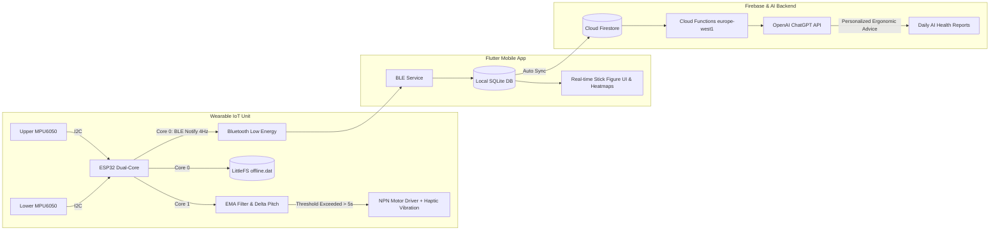

<p align="center">
  <a href="README.md"><b>English</b></a> •
  <a href="README.tr.md"><b>Türkçe</b></a>
</p>

<h1 align="center">Sensor-Based Posture and Activity Tracking IoT Device and Mobile Application</h1>

<p align="center">
  
  
  
  
  
  
  
  
</p>

---


<summary><h3>Authors & Academic Notice</h3></summary>

This project was developed as a Senior Capstone Project (BSM 498 Bitirme Çalışması) at **Sakarya University, Faculty of Computer and Information Sciences, Department of Computer Engineering**.

- **Elşat Mirdesoğlu** - Computer Engineering
- **Metin Hakan Yılmaz** - Computer Engineering
- **Advisor:** Assoc. Prof. Dr. Abdullah Sevin

---


<summary><h3>Table of Contents</h3></summary>

- [Overview & The Problem](#overview--the-problem)
- [Key Features](#key-features)
- [System Architecture](#system-architecture)
  - [Hardware & Embedded Engineering](#hardware--embedded-engineering)
  - [Mathematical Model & Digital Filtering](#mathematical-model--digital-filtering)
  - [Mobile & Cloud Ecosystem](#mobile--cloud-ecosystem)
- [Project Documentation & Research Papers](#project-documentation--research-papers)
- [Quick Start & Installation](#quick-start--installation)


---

<details open>
<summary><h3>Overview & The Problem</h3></summary>

Prolonged sedentary working hours and poor ergonomic habits significantly contribute to musculoskeletal disorders (MSDs), notably in the cervical and lumbar spine. 

Existing commercial products on the market (such as *Upright Go 2* or *Lumo Back*) rely on a **single sensor placed on either the upper or lower back**. A single sensor cannot distinguish between a user merely leaning forward naturally while keeping a straight spine and genuine thoracic kyphosis (slouching/hunching).

**Sensor-Based Posture and Activity Tracking IoT Device and Mobile Application** solves this fundamental limitation by employing a **dual-IMU sensory system** combined with an **ESP32 dual-core wearable harness**, **sub-second BLE telemetry**, **offline flash buffering**, and a **Flutter mobile app integrated with Firebase and LLM-based coaching**.

</details>

---

<details open>
<summary><h3>Key Features</h3></summary>

- **Real-Time Interactive Stick Figure:** The mobile app renders an animated 2D skeleton mirroring the user's upper body angles in real time.
- **Activity & Step Tracking:** Distinguishes between sitting, standing, and walking; visualizes daily active hours and steps through interactive charts.
- **Posture Heatmap Calendar:** GitHub-style 3-month posture consistency calendar indicating daily upright duration scores.
- **Daily AI Health Coach:** Merges daily spinal logs with subjective End-of-Day (EOD) energy/pain reviews and generates personalized, actionable ergonomic feedback using LLMs.
- **Social & Gamification:** Add friends, monitor peer weekly streaks, celebrate milestones, and unlock physical activity achievements with push notification triggers.
- **Offline-First & Multi-Language:** Seamless offline operation with SQLite local storage, auto-sync upon internet availability, and English/Turkish localized interfaces.

</details>

---

<details open>
<summary><h3>System Architecture</h3></summary>

#### Hardware & Embedded Engineering



- **Microcontroller:** ESP32-WROOM-32 (240 MHz dual-core Xtensa LX6, FreeRTOS).
  - **Core 1:** 100 Hz kinematic sensor data polling, trigonometric pitch/roll calculations, and EMA filtering.
  - **Core 0:** BLE GATT server transmission (4 JSON packets/sec) and flash storage management.
- **Power Management:** 18650 3.7V 5200mAh Li-ion battery, TP4056 Type-C charging circuit with high-side PNP BJT switch for automatic USB/battery power routing.
- **Actuator:** Eccentric Rotating Mass (ERM) coin vibration motor driven by an NPN transistor circuit from 3.3V supply to prevent inductive kickback and pin overload.
- **Offline Resilience:** When out of BLE range, measurements are stored as tightly-packed 12-byte binary structs into **LittleFS flash memory (`offline.dat`)**. Upon reconnecting, data is burst-transmitted (`bulk:start` $\rightarrow$ `bulk:end`) and synced without data loss.

#### Mathematical Model & Digital Filtering

1. **Pitch (Inclination Angle):**
   $$\text{Pitch} = \text{atan2}\left(A_y, \sqrt{A_x^2 + A_z^2}\right) \times \frac{180}{\pi}$$
2. **Digital Noise Filtering (Exponential Moving Average - EMA):**
   $$Y[n] = \alpha \cdot X[n] + (1 - \alpha) \cdot Y[n-1] \quad (\alpha = 0.05)$$
   Filters involuntary muscle tremor and breathing noise while maintaining responsive tracking without human-perceptible lag.
3. **Slouch Decision Mechanism:**
   $$\Delta \text{Pitch} = |\text{Pitch}_{\text{Upper}} - \text{Pitch}_{\text{Lower}}|$$
   - **Trigger:** $\Delta \text{Pitch} \ge 15.0^{\circ}$ sustained for $5000\text{ ms}$.
   - **Hysteresis:** Vibration stops when returning within $12.0^{\circ}$ ($3.0^{\circ}$ hysteresis offset).

</details>

---

<details open>
<summary><h3>Project Documentation & Research Papers</h3></summary>

The complete graduation thesis, presentation slides, and scientific conference poster are available inside the [`docs/`](docs/) directory:

| Document | Format | Description | Direct Link |
| :--- | :---: | :--- | :---: |
| **Graduation Thesis** | PDF | Comprehensive 52-page academic thesis with mathematical proofs, schematics, and test results. | [View Thesis](docs/tr_thesis.pdf) |
| **Project Poster** | PPTX | Academic exhibition poster summarizing hardware, methodology, and results. | [View Poster](docs/tr_poster.pptx) |
| **Presentation Deck** | PPTX | Defense presentation slides detailing system architecture and benchmarks. | [View Slides](docs/tr_presentation.pptx) |

</details>

---

<details open>
<summary><h3>Quick Start & Installation</h3></summary>

#### Option 1: One-Click Automated Setup

Run the automated setup script from the root repository directory:

- **Windows:**
  ```cmd
  setup.bat
  ```
- **macOS / Linux:**
  ```bash
  chmod +x setup.sh && ./setup.sh
  ```

*The script verifies system requirements (`flutter`, `node`, `npm`), installs Cloud Functions packages, resolves Flutter dependencies, and sets up template configurations.*

---

#### Option 2: Manual Setup

1. **Cloud Functions Dependencies:**
   ```bash
   cd functions
   npm install
   cd ..
   ```

2. **Mobile App Dependencies:**
   ```bash
   cd mobile/posture_corrector
   flutter pub get
   ```

3. **Firebase Configuration:**
   - Place your `google-services.json` into `mobile/posture_corrector/android/app/`.
   - Place your `GoogleService-Info.plist` into `mobile/posture_corrector/ios/Runner/`.

4. **Run Mobile App:**
   ```bash
   cd mobile/posture_corrector
   flutter run
   ```

5. **Flash Firmware to ESP32:**
   - Open [`hardware/posture_corrector_firmware.ino`](hardware/posture_corrector_firmware.ino) in Arduino IDE or PlatformIO.
   - Select Board: `ESP32 Dev Module` (Partition Scheme: `Default with LittleFS`).
   - Connect pins as specified in Section 2 of the [Thesis](docs/tr_thesis.pdf) and upload.

</details>
