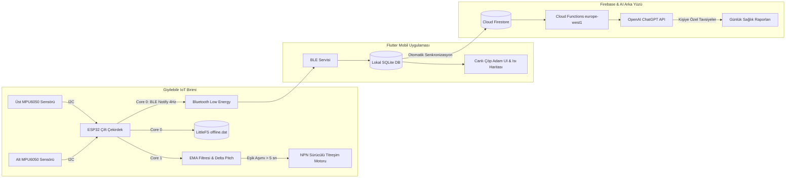

<p align="center">
  <a href="README.md"><b>English</b></a> •
  <a href="README.tr.md"><b>Türkçe</b></a>
</p>

<h1 align="center">Sensör Tabanlı Poz ve Aktivite Takibi Sağlayan IoT Cihazı ve Mobil Uygulaması</h1>

<p align="center">
  
  
  
  
  
  
  
  
</p>

---


<summary><h3>Geliştiriciler ve Akademik Bilgi</h3></summary>

Bu çalışma, **Sakarya Üniversitesi Bilgisayar ve Bilişim Bilimleri Fakültesi, Bilgisayar Mühendisliği Bölümü** bünyesinde **BSM 498 Bitirme Çalışması** olarak gerçekleştirilmiştir.

- **Elşat Mirdesoğlu** - Bilgisayar Mühendisliği
- **Metin Hakan Yılmaz** - Bilgisayar Mühendisliği
- **Tez Danışmanı:** Doç. Dr. Abdullah Sevin


---


<summary><h3>İçindekiler</h3></summary>

- [Genel Bakış ve Problem Tanımı](#genel-bakış-ve-problem-tanımı)
- [Temel Özellikler](#temel-özellikler)
- [Sistem Mimarisi](#sistem-mimarisi)
  - [Donanım ve Gömülü Sistem Tasarımı](#donanım-ve-gömülü-sistem-tasarımı)
  - [Matematiksel Modeller ve Dijital Filtreleme](#matematiksel-modeller-ve-dijital-filtreleme)
  - [Mobil Uygulama ve Bulut Altyapısı](#mobil-uygulama-ve-bulut-altyapısı)
- [Proje Dokümantasyonu (Tez, Poster, Sunum)](#proje-dokümantasyonu-tez-poster-sunum)
- [Hızlı Başlangıç ve Kurulum](#hızlı-başlangıç-ve-kurulum)


---

<details open>
<summary><h3>Genel Bakış ve Problem Tanımı</h3></summary>

Masa başı çalışma sürelerinin artması ve hareketsiz yaşam tarzı; boyun, sırt ve bel bölgelerinde kronik kas-iskelet sistemi rahatsızlıklarına (MSD) yol açmaktadır.

Piyasada bulunan mevcut ticari ürünler (*Upright Go 2*, *Lumo Back* vb.) **yalnızca sırtta ya da yalnızca belde konumlandırılan tek bir IMU sensörü** ile çalışmaktadır. Tek sensörlü yapı; kullanıcının omurgasını dik tutarak sandalyede öne doğru doğal eğilmesi ile gerçek omurga kamburlaşması (kifoz) arasındaki farkı ayırt edememekte ve sık sık hatalı uyarılar üretebilmektedir.

Bu çalışma, bu temel problemi çözmek için **çift IMU (MPU6050) sensörlü giyilebilir bir gömülü sistem**, **çift çekirdekli ESP32 mimarisi**, **düşük güç tüketimli BLE telemetrisi**, **çevrimdışı flaş önbellekleme** ve **LLM destekli ergonomik koçluk sunan Flutter mobil uygulaması** ile bütünleşik bir çözüm sunar.

</details>

---

<details open>
<summary><h3>Temel Özellikler</h3></summary>

- **Canlı Çöp Adam Göstergesi:** Kullanıcının duruş açılarını mobil ekranda gerçek zamanlı 2 boyutlu iskelet animasyonuyla gösterir.
- **Aktivite & Adım Sayımı:** Gün içindeki oturma, ayakta kalma ve adım verilerini dinamik ivmeölçer analizi ile takip eder.
- **Duruş Isı Haritası:** Kullanıcının son 3 aydaki dik duruş alışkanlığını renk yoğunluklu takvim üzerinden görselleştirir.
- **Yapay Zekâ Destekli Günlük Raporlama:** Sensör verilerini ve kullanıcının gün sonu değerlendirmelerini (ağrı/enerji puanı) LLM ile birleştirerek kişiselleştirilmiş ergonomik tavsiyeler üretir.
- **Sosyal Paylaşım & Başarımlar:** Arkadaş ekleme, haftalık serileri takip etme, kutlama bildirimleri gönderme ve rozet kazanma özellikleri ile motivasyon sağlar.
- **Çevrimdışı Öncelikli (Offline-First) & Çok Dilli:** SQLite lokal depolama, internet geldiğinde otomatik Firestore senkronizasyonu ve Türkçe/İngilizce tam dil desteği.

</details>

---

<details open>
<summary><h3>Sistem Mimarisi</h3></summary>

#### Donanım ve Gömülü Sistem Tasarımı



- **Mikrodenetleyici:** ESP32-WROOM-32 (240 MHz çift çekirdekli Xtensa LX6, FreeRTOS).
  - **Core 1:** 100 Hz hızında sensör okuma, trigonometrik pitch/roll açı hesaplamaları ve EMA filtreleme.
  - **Core 0:** BLE GATT Notify üzerinden veri aktarımı (saniyede 4 JSON paketi) ve dosya sistemi yönetimi.
- **Güç Yönetimi:** 18650 3.7V 5200mAh Li-ion batarya, TP4056 Type-C şarj devresi ve USB takıldığında otomatik geçiş sağlayan yüksek taraf PNP BJT anahtarlama mimarisi.
- **Titreşim Birimi:** Minyatür şaftsız eksantrik dönen kütleli (ERM) titreşim motoru; NPN transistör anahtarlaması ve 3.3V gerilim hattıyla sürülerek aşırı akım ve endüktif geri tepmelere karşı korunmuştur.
- **Çevrimdışı Güvenilirlik:** Cihaz telefon menzilinde değilken sensör verileri 12 byte'lık kompakt binary struct'lar halinde **LittleFS (`offline.dat`)** flaş belleğine yazılır. Tekrar bağlanıldığında toplu (`bulk:start` $\rightarrow$ `bulk:end`) olarak telefona aktarılır ve veri kaybı önlenir.

#### Matematiksel Modeller ve Dijital Filtreleme

1. **Eğim Açısı (Pitch Formülü):**
   $$\text{Pitch} = \text{atan2}\left(A_y, \sqrt{A_x^2 + A_z^2}\right) \times \frac{180}{\pi}$$
2. **Dijital Gürültü Filtreleme (Üstel Hareketli Ortalama - EMA):**
   $$Y[n] = \alpha \cdot X[n] + (1 - \alpha) \cdot Y[n-1] \quad (\alpha = 0.05)$$
   Nefes alıp verme, kas seğirmeleri ve elektriksel gürültüleri filtrelerken tepkisellikte gecikme yaratmaz.
3. **Kamburluk Karar Mekanizması:**
   $$\Delta \text{Pitch} = |\text{Pitch}_{\text{Üst}} - \text{Pitch}_{\text{Alt}}|$$
   - **Uyarı Eşiği:** $\Delta \text{Pitch} \ge 15.0^{\circ}$ değerinin $5000\text{ ms}$ boyunca aşılması.
   - **Histeresis Payı:** Duruş $12.0^{\circ}$ altına indiğinde titreşim kesilir ($3.0^{\circ}$ histeresis toleransı).

</details>

---

<details open>
<summary><h3>Proje Dokümantasyonu (Tez, Poster, Sunum)</h3></summary>

Projenin akademik tez metni, seminer posteri ve sunum slaytları [`docs/`](docs/) klasöründe yer almaktadır:

| Doküman | Format | Açıklama | Doğrudan Bağlantı |
| :--- | :---: | :--- | :---: |
| **Bitirme Tezi** | PDF | 52 sayfalık kapsamlı akademik tez metni, devre şemaları, matematiksel modeller ve test sonuçları. | [Tezi İncele](docs/tr_thesis.pdf) |
| **Proje Posteri** | PPTX | Donanım bileşenlerini, metodolojiyi ve sonuçları özetleyen akademik sunum posteri. | [Posteri İncele](docs/tr_poster.pptx) |
| **Sunum Slaytları** | PPTX | Sistem mimarisini ve mühendislik aşamalarını içeren jüri savunma sunumu. | [Sunumu İncele](docs/tr_presentation.pptx) |

</details>

---

<details open>
<summary><h3>Hızlı Başlangıç ve Kurulum</h3></summary>

#### Seçenek 1: Tek Tıkla Otomatik Kurulum

Proje kök dizininde işletim sisteminize uygun scripti çalıştırın:

- **Windows:**
  ```cmd
  setup.bat
  ```
- **macOS / Linux:**
  ```bash
  chmod +x setup.sh && ./setup.sh
  ```

*Bu script sisteminizdeki gereksinimleri (`flutter`, `node`, `npm`) denetler, Cloud Functions paketlerini kurar, Flutter bağımlılıklarını çözer ve örnek konfigürasyonları hazırlar.*

---

#### Seçenek 2: Manuel Kurulum

1. **Cloud Functions Bağımlılıkları:**
   ```bash
   cd functions
   npm install
   cd ..
   ```

2. **Mobil Uygulama Bağımlılıkları:**
   ```bash
   cd mobile/posture_corrector
   flutter pub get
   ```

3. **Firebase Yapılandırması:**
   - `google-services.json` dosyasını `mobile/posture_corrector/android/app/` dizinine yerleştirin.
   - `GoogleService-Info.plist` dosyasını `mobile/posture_corrector/ios/Runner/` dizinine yerleştirin.

4. **Mobil Uygulamayı Başlatma:**
   ```bash
   cd mobile/posture_corrector
   flutter run
   ```

5. **Gömülü Yazılımı ESP32'ye Yükleme:**
   - [`hardware/posture_corrector_firmware.ino`](hardware/posture_corrector_firmware.ino) dosyasını Arduino IDE veya PlatformIO ile açın.
   - Kart: `ESP32 Dev Module` (Partition: `Default with LittleFS`).
   - [Tez Metnindeki](docs/tr_thesis.pdf) pin şemasına göre devre bağlantılarını yapıp yükleyin.

</details>
